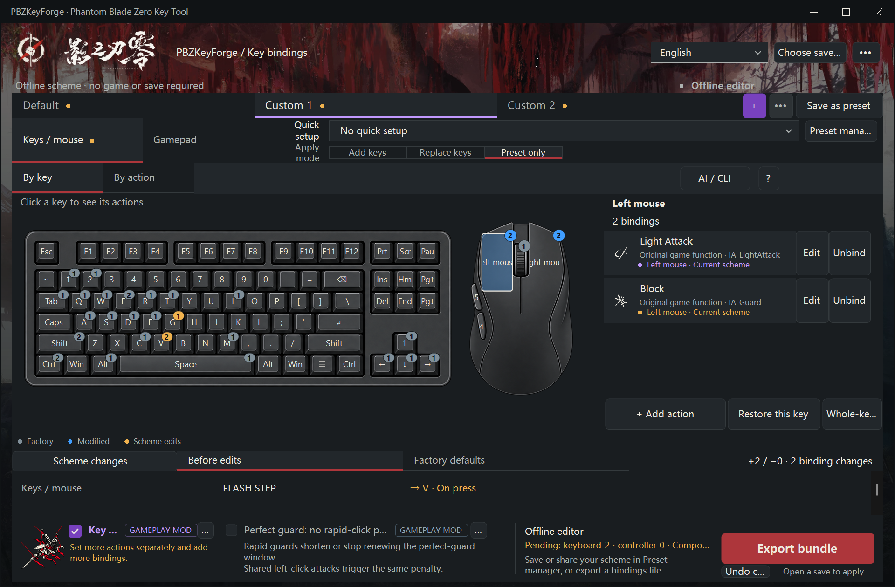
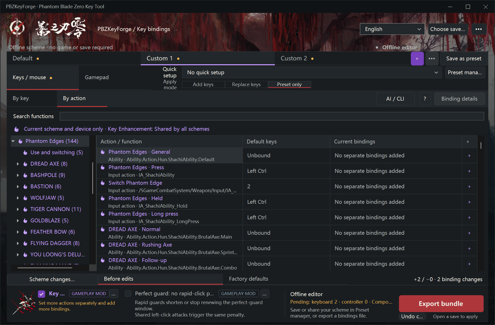
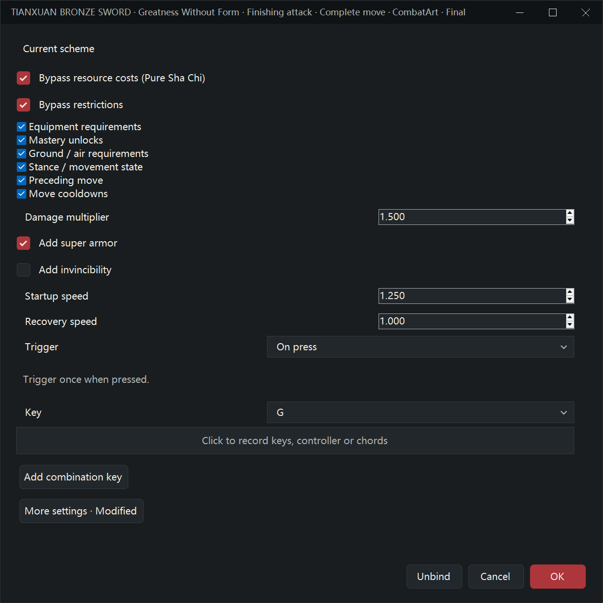
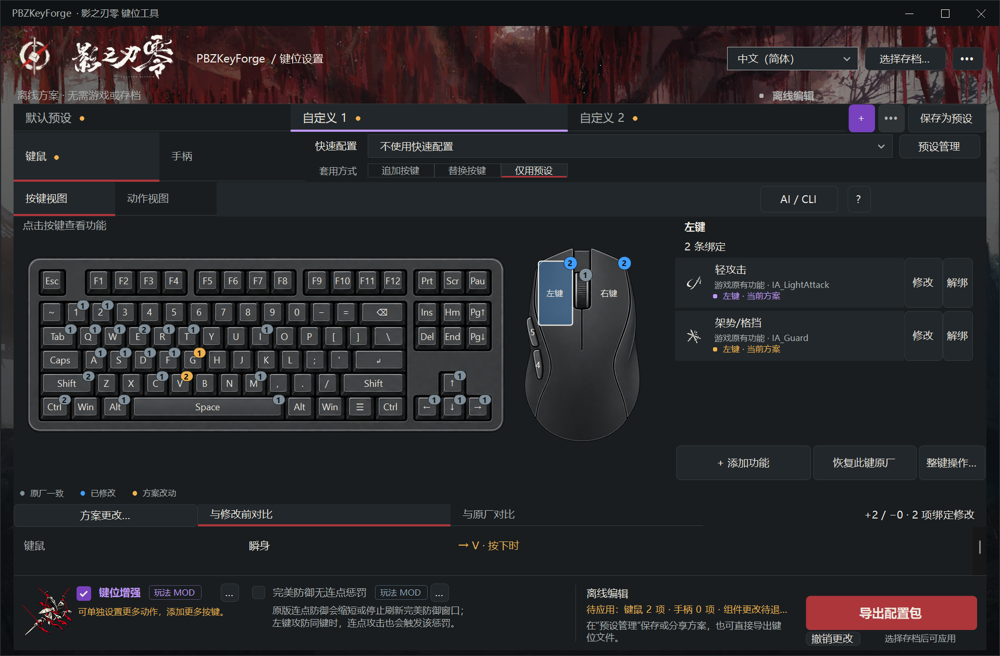
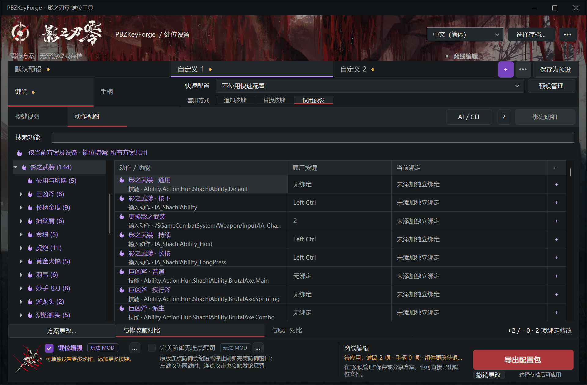
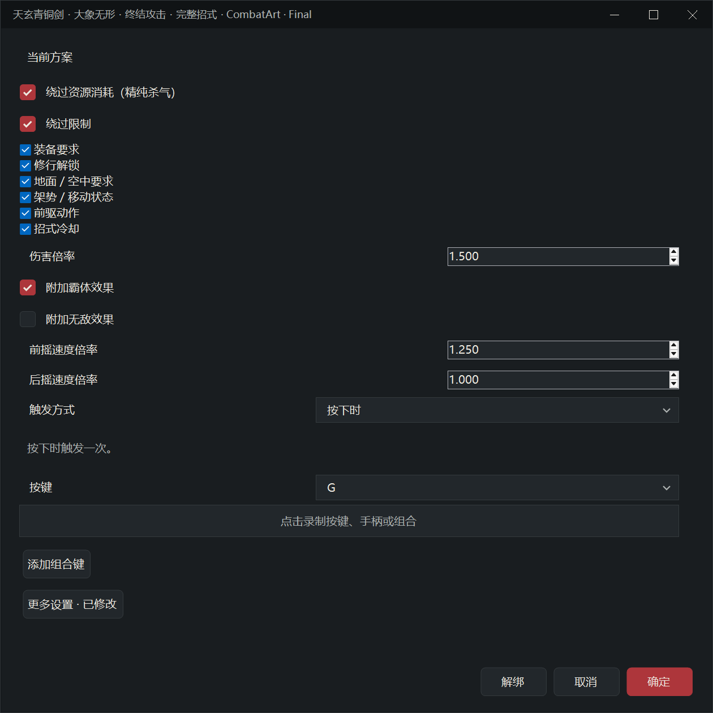

# PBZKeyForge

[Project](https://github.com/muyuanjin/PBZKeyForge) · [Nexus Mods](https://www.nexusmods.com/phantombladezero/mods/402) · [Releases](https://github.com/muyuanjin/PBZKeyForge/releases) · [Kintaro UE4SS](https://github.com/KintaroModding/ue4ss)

**English** · [简体中文](#简体中文)

A key binding editor for **Phantom Blade Zero** that writes the game's own input settings file directly, so a single key can drive several actions at once — something the in-game rebinding screen refuses to save because it reports a conflict.

`PBZKeyForge.exe` · single file · no installer · no .NET runtime download · Windows 10/11







[Feature screenshots in English and Simplified Chinese](assets/screenshots/1.3.1/README.md)

---

## Why this exists

Phantom Blade Zero stores your key bindings in a plain GVAS file:

```
<Steam>\steamapps\common\PBZ\ProjectPBZ\Saved\EnhancedInputUserSettings.sav
```

The in-game screen validates on **save**, not at runtime, and it rejects any binding where two actions share a key. The engine itself has no such limitation: the mapping data is a list of per-action overrides, and duplicate keys simply fire both actions. This tool edits those overrides directly, which is exactly the edit the settings screen will not let you make.

## Features

- **One key, several actions.** Guard on the attack key, dodge on the guard key, whatever you want.
- **Key Enhancement.** Add unlimited bindings, chords, sequences, tap/hold and extra functions through the existing key and action views. Search weapon and Phantom Edge moves by their game names. Tune resources, restriction bypasses, damage, timing and move effects per binding. Independent schemes can be switched through bindings in game. The mode switch stages it and Apply installs it; restart the game after installation, then edit bindings live. [Usage and limits](docs/key-enhancement.md).
- **Scheme aware.** Pick which scheme you are editing — `Default`, `Custom 1`, `Custom 2` — and switch the game to it from the tool.
- **Two editing views.** Click keyboard, mouse or controller buttons to edit their actions, or edit bindings by action. Factory, customized and pending bindings have distinct badge colors; the bottom panel compares the whole scheme.
- **Quick setups** for one-key guard, a Souls-style gamepad layout, and Space-based movement; restore the selected scheme's defaults from the same list.
- **Personal presets and sharing.** Save named layouts, preview and import compact share codes, share only selected devices, export a game settings file, and batch-delete personal presets.
- **Offline editing.** Create keyboard/mouse, Xbox and PlayStation layouts without installing the game, owning a controller or loading a save. Each controller family can be edited and shared separately.
- **15 languages** — English, 简体中文, 繁體中文, 日本語, 한국어, Français, Deutsch, Español (España / Latinoamérica), Português (Brasil / Portugal), Русский, Italiano, ไทย, Tiếng Việt. Auto-detected from Windows, switchable in the toolbar.
- **Explicit binding choices.** Default inherits the factory key; Unbound removes it. Unrelated save data is preserved.
- **Safe writes.** The game must be closed, a timestamped backup is written first, and the file is re-read and verified after saving.
- **Optional removal of the perfect-guard rapid-click penalty.** The **Perfect guard: no rapid-click penalty** checkbox and **GAMEPLAY MOD** badge on the right side of the footer enable or remove the rapid-guard penalty override through **Apply changes**. Applies to every difficulty and guard key; no exact game-version gate. See [installation and compatibility](docs/perfect-deflect-no-rapid-click-penalty-mod.md).

## Updates and credits

**More → About and updates** checks the latest stable application release and offers **Update and restart**. It downloads the complete package, updates GUI/CLI and documentation, and retains saves, personal presets, preferences and game Mod configuration. Failed replacement restores earlier files; GitHub and Nexus Mods links remain available for manual downloads. Game Mod updates are managed separately.

Key Enhancement loads PBZInputRouter through [KintaroModding’s PBZ UE4SS](https://github.com/KintaroModding/ue4ss). It routes supported gameplay inputs; menu, text and unsupported pipelines remain native. Thanks to KintaroModding, the [UE4SS community](https://github.com/UE4SS-RE/RE-UE4SS), protobuf-net, controller artwork contributors and players. Licenses and attribution: [THIRD-PARTY-NOTICES.md](THIRD-PARTY-NOTICES.md).

## Install

1. Close Phantom Blade Zero completely.
2. Download the release zip and extract it anywhere.
3. Back up your own file first:

```
<Steam>\steamapps\common\PBZ\ProjectPBZ\Saved\EnhancedInputUserSettings.sav
```

Two ways to use it:

**A. The GUI** — run `PBZKeyForge.exe`; it finds and reads the save automatically. Choose a scheme, edit bindings or select a quick configuration, then press *Apply changes*. Switching schemes reads the latest disk data; *Refresh* also preserves unsaved drafts and asks you to resolve conflicting edits. Use *More* to choose another save.

The editor remembers the last successfully opened file and reads it again at startup. If it has moved or cannot be opened, discovery continues through Steam's registered libraries and installation manifests, then common `SteamLibrary` locations. **More → Find game again** searches the installation locations afresh. If several installations exist, manually choose the one you want; that choice is used on the next launch.

If no save is found, the editor opens an offline scheme using built-in factory bindings. You can also choose **More → New offline scheme**. Select Keyboard/mouse or Controller, then choose Xbox or PlayStation in the controller selector. Save or share the layout through Preset manager, or use **Export game bindings** in the footer to create a `.sav` file. Offline editing does not require a game installation or a connected controller; applying directly to the game requires opening its save.

Keyboard and gamepad drafts both belong to the selected scheme. Applying saves that scheme's bindings; other schemes' drafts stay pending. The footer lists what will be applied. Check *Set game scheme to…* to activate it in the same operation, or leave it unchecked to edit an inactive scheme. Consecutive quick configuration selections replace the previous preview; manual edits keep the result as a custom draft. *Restore all defaults* lives in *More* and previews a reset of both devices in every scheme before applying.

**B. A ready-made preset** — use `presets\PRESETS.md` to choose a file, copy it over `EnhancedInputUserSettings.sav`, then select the listed scheme in game. The release files target **Custom 1**; replacing this file does not switch the active game scheme. These are plain settings files, no executable involved.

**By key** shows a clickable keyboard and mouse together. Number badges count actions: gray for factory mappings, blue for applied customization, yellow for pending changes. Controller face-button and D-pad badges spread outward; LT/RT include both axis and digital inputs. Select a key to edit its actions on the right. The full-width bottom panel compares the entire scheme with either its saved state or factory defaults, including controller changes. Each row shows additions first, retained keys next, and gray struck-through removals last. Click its binding content to cycle through combined, changes-only, result-only and before views. **By action** lists functions and all their bindings; search also finds additional functions by name or code. Both perspectives share the same draft.

Select a key and choose **Add function**, or open an action's binding details to add, edit, remove or restore its bindings. Ordinary single keys use available save slots; key enhancement adds complex inputs and additional bindings in the same dialogs. Both the full action key set and the raw slot defaults come from the supported game's input resources. The fixed Ctrl hold mapping for Phantom Edges remains active independently of editable save slots. See [default binding sources and limits](docs/input-defaults.md).

## Perfect guard: no rapid-click penalty

Check **Perfect guard: no rapid-click penalty** on the right side of the footer, then click **Apply changes** to remove the rapid-guard penalty. The option is off by default. Click **?** for a short explanation; uncheck and apply to restore the original rules. Exit the game before applying. All schemes and guard keys share this change.

Each click uses the game’s current base perfect-guard window, including its difficulty, accessory and guard-break rules. The patch changes one cooldown value in each of five difficulty configuration assets and preserves the game’s combat scripts. Installation uses embedded resources and requires no Python, retoc, Oodle or network connection. See [installation and known limits](docs/perfect-deflect-no-rapid-click-penalty-mod.md).

## My presets and sharing

Use **Preset manager** beside Quick setups to name and save the current scheme, including unapplied edits. Your presets appear separately from built-in presets. Select one to preview or copy its one-line share code; check several to delete them. Deleting a preset keeps your current bindings.

Paste a share code and preview it before saving or using it. It includes the name and only the changes from factory defaults. Beside **Copy share code**, choose all included devices, keyboard/mouse, controllers, or a specific controller family; the character count updates immediately. Imported presets show their included devices. **Preset only** restores and applies only those devices, preserving devices outside the preset's scope. Choose directly from **Add keys**, **Replace keys**, and **Preset only** beside Quick setups; all three choices stay visible, with details on hover. The application starts with Preset only and remembers your selected mode across launches. Using a preset creates a draft; **Apply changes** in the main window writes it to the game.

**Save as preset** in the scheme bar saves the current draft with a name and device scope. Presets and share codes include the selected enhancement scheme; preset modes merge or replace bindings for the included devices. **Export game bindings** writes a `.sav` copy for ordinary bindings or a ZIP containing the full enhancement scheme library. Export does not activate a scheme or overwrite the source save. Your preset library is stored in `%LOCALAPPDATA%\PBZKeyForge\Presets`.

## Presets

| Preset | What it does |
| --- | --- |
| `onekey` | Adds guard to left mouse / X while keeping right mouse / LB and other existing guard bindings. |
| `mouse_guard` | Keyboard / mouse only: left mouse light attack + guard; right mouse heavy attack + guard; F remains heavy attack. Replaces these three actions' bindings. |
| `mouse_guard_space` | Keyboard / mouse only: the same mouse attack + guard layout; Space combines dodge and jump; W/A/D sprint. F retains heavy attack; Shift retains dodge. |
| `onekey_dodge` | Moves guard to left mouse / X; right mouse / LB become dodge + sprint. Replaces the affected actions' bindings. |
| `souls` | Souls-style gamepad: light RB, heavy RT, guard LB, dodge/sprint A, interact/execute Y. |
| `space_sprint` | Adds Space as a second sprint key; Shift stays. |
| `space_dodge` | Adds Space as a second dodge key; Shift stays. |
| `vanilla` | Removes every override and returns to the shipped defaults. |

The eight save files (seven custom layouts and one factory layout) and their bilingual `PRESETS.md` index are generated from the editor's preset definitions. Each file contains factory bindings plus its preset, matching the hover preview and **Preset only** mode. The editor also offers restoring the selected scheme in Quick configuration and restoring all schemes in More; both use the same factory bindings with different scopes.

## Command line (build pipeline only)

`PBZKeyForge-cli.exe` is built by the same script but is not part of the download. The release workflow uses it to generate the preset files and to run the round-trip check, and it is handy when writing them:

```
PBZKeyForge-cli.exe --selftest <sav>
PBZKeyForge-cli.exe --schemes <sav>
PBZKeyForge-cli.exe --list <sav>
PBZKeyForge-cli.exe --apply-preset <in.sav> <out.sav> <presetId> [--scheme <profileId>]
PBZKeyForge-cli.exe --activate <installed.sav> <profileId>
PBZKeyForge-cli.exe --make-vanilla <in.sav> <out.sav>
PBZKeyForge-cli.exe --gen-presets <in.sav> <outDir>
```

`--selftest` re-encodes the file without changes and compares it byte-for-byte with the input; it is the acceptance test this project is built around.

Activating a scheme edits only `KeyBindingScheme` in the adjacent `PBZSharedSetting.sav`. The game must be closed. The tool backs up that file outside the game folder, authenticates it, and verifies the replacement before writing. Reading this setting requires the installed Steam executable; unsupported builds are rejected. The profile identifier in `EnhancedInputUserSettings.sav` does not control the game's selected scheme.

## Important

- **Do not open the in-game keybind screen and press apply or reset after using this tool.** The game validates on its own save and rewrites the whole file, discarding these bindings. If you do, just re-apply.
- Only one mod that replaces `EnhancedInputUserSettings.sav` can be active at a time.
- Editing an inactive scheme's keyboard and gamepad bindings is supported. Check *Set game scheme to…* and press *Apply changes* when you want the game to use it. Gamepad records are matched by `ProfileId`; another scheme's records are preserved even when their `Family` values are identical.
- Supports the Steam launch build (`CL-301524`) and patch 1.0302256 (`CL-302256`), including their different Phantom Edge slot rules and both scheme-activation readers. Later builds with the same key-derivation instructions and PBZS format can be discovered and authenticated locally; initial discovery runs in the background. Find interaction rebinding under *Action view → Interact / Talk*, or select E / B / Circle in Key view. Existing presets/share codes remain compatible. See [version evidence and validation scope](docs/game-version-compatibility.md). The tool refuses to write files it cannot parse or authenticate.

## Build from source

No SDK required — the .NET Framework compiler that ships with Windows is enough.

```powershell
powershell -ExecutionPolicy Bypass -File build\build.ps1
```

Outputs `dist\PBZKeyForge.exe` (GUI) and `dist\PBZKeyForge-cli.exe` (console, build pipeline only).

## Release screenshots

```powershell
powershell.exe -NoProfile -ExecutionPolicy Bypass -File build\capture-screenshots.ps1
```

Captures ten scenes in English and Simplified Chinese, producing 20 images and a linked index in `assets/screenshots/<application-version>/`. Keyboard/mouse, Xbox and PlayStation main windows have the preset dropdown expanded (`main-<language>.png`, `main-gamepad-<language>.png` and `main-playstation-<language>.png`). Separate feature shots show unobstructed key and action views, factory/unbound choices, saving a preset, device scopes for sharing, and share-code import previews. By default, the script opens the editor's offline scheme, selects the real Xbox or PlayStation editing family, stages built-in presets in memory, and never applies them. Preset examples use a temporary library that is removed after capture. Local paths and personal preset names are excluded. Keep the Windows desktop unlocked; the editor briefly comes to the foreground.

Use `-SavePath <save>` to choose an input, `-ApplicationPath <exe>` for a particular build, `-Preset <id>` / `-ControllerPreset <id>` to change keyboard/mouse and controller previews, or `-OutputDir <directory>` to choose the output. Use `-Shots main,main-gamepad,main-playstation` for just the six expanded-list main screenshots. See [publishing](docs/publishing.md#versioned-screenshots-and-page-description) for the versioned Nexus media and illustrated homepage update steps.

## License

Original project code and documentation: MIT. Game-derived text, artwork, resource
data and decoded instruction excerpts retain the original rights holders' rights
and are outside this MIT grant. See [third-party notices](THIRD-PARTY-NOTICES.md#phantom-blade-zero-game-derived-material).
Not affiliated with S-Game. Use at your own risk, keep the backup.

---

## 简体中文

**更多 → 关于与更新** 可检查正式版本并自动下载、重启更新程序，同时更新 GUI、CLI 和说明文件，保留存档、个人预设、偏好及游戏 Mod 配置。替换失败会恢复已替换的旧文件；自动更新失败时，可选择 GitHub 或 Nexus Mods 手动下载。游戏 Mod 更新独立管理。

键位增强通过 [KintaroModding 的影之刃零 UE4SS](https://github.com/KintaroModding/ue4ss) 加载 PBZInputRouter，接管受支持的玩法输入。菜单、文本及未支持的管线仍由游戏执行。感谢 KintaroModding、[UE4SS 社区](https://github.com/UE4SS-RE/RE-UE4SS)、protobuf-net、手柄素材贡献者和玩家反馈。完整许可和致谢见 [THIRD-PARTY-NOTICES.md](THIRD-PARTY-NOTICES.md)。

直接改写《影之刃零》自己的按键设置文件，让一个键同时触发多个动作——游戏内的改键界面会因为"按键冲突"拒绝保存，而引擎本身并不限制这件事。

`PBZKeyForge.exe` · 单文件 · 免安装 · 不需要额外下载 .NET 运行时 · Windows 10/11

键位增强使用 x64 UE4SS，需要最新版 [Microsoft Visual C++ v14 x64 运行库](https://aka.ms/vc14/vc_redist.x64.exe)。启用和更新前会检查实际依赖，缺失或过旧时提供修复提示；普通改键、预设和离线编辑不需要它。







[中英文功能截图](assets/screenshots/1.3.1/README.md)

### 为什么需要它

游戏把键位存在一个明文 GVAS 文件里：

```
<Steam>\steamapps\common\PBZ\ProjectPBZ\Saved\EnhancedInputUserSettings.sav
```

游戏界面只在**保存时**校验，而运行时并不拦；数据本身就是一组"按动作覆盖"的记录，同一个键写进两个动作就会同时触发。这个工具改的就是这些记录——也正是游戏界面不让你做的那一步。

### 功能

- **一个键多个动作**：防御并到攻击键、闪避并到防御键，随便配。
- **键位增强**：沿用原来的按键和动作入口，添加不限槽位的绑定、组合、顺序输入、短按／长按及额外招式，招式采用游戏显示名称，可逐绑定设置资源、限制绕过、伤害、前后摇及附加效果。增强方案独立保存，支持游戏内按键切换。底部开关暂存启用，应用后安装；重启游戏加载后可实时编辑。[使用说明与边界](docs/key-enhancement.md)。
- **认方案**：可选编辑 `默认 / 自定义方案 1 / 自定义方案 2`，并能在工具里直接把某个方案设为游戏当前生效方案。
- **两种视图**：按键视图可点击键鼠和手柄图形，动作视图按功能编辑；徽标区分原厂、已修改和待应用，底部显示整个方案的差异。
- **自己的预设**：命名保存、分享码预览导入、按设备分享、导出游戏键位文件，也可批量删除个人预设。
- **离线配键**：没有安装游戏、没有存档、没有连接过手柄，也能编辑键鼠、Xbox 和 PlayStation，分别保存、分享和导出。
- **快速配置**：左键兼防御、左轻右重，双键防御、双键攻防，自动疾跑、左键攻防，右键闪避、魂系手柄布局、空格高速移动、空格闪避、恢复原厂。
- **15 种语言**：简中、繁中、英、日、韩、法、德、西班牙西语、拉美西语、巴西葡语、葡萄牙葡语、俄、意、泰、越，覆盖游戏的界面语言；自动识别系统语言，也能在工具栏切换。
- **明确绑定状态**：“默认”继承原厂键位，“无绑定”明确解绑；保留存档中的无关内容。
- **写入安全**：游戏必须退出、先打时间戳备份、写完回读校验。

### 安装

1. 完全退出游戏。
2. 解压发布包。
3. 先备份你自己的 `EnhancedInputUserSettings.sav`。

两种用法：

- **图形界面**：运行 `PBZKeyForge.exe` 自动查找并读取存档 → 选方案 → 直接改键或选择快速配置 → 应用更改。“更多”中可以更换存档。
- **现成预设文件**：按 `presets\PRESETS.md` 中的名称和说明选择文件，覆盖到 `EnhancedInputUserSettings.sav`，进游戏选择表中的方案。发布包中的预设作用于**自定义 1**，替换文件不会自动切换游戏当前方案。纯配置、不含可执行文件。

程序记住上次成功打开的文件，启动时重新读取。文件已移动或无法打开时，继续按 Steam 登记的游戏库和安装清单查找，再尝试常见的 `SteamLibrary` 位置。“更多 → 重新查找游戏”会重新按安装位置检测。存在多份安装时，手动选择要编辑的那份，下次启动会沿用这一选择。

没有找到存档时，程序直接打开内置原厂键位的离线方案，也可通过“更多 → 新建离线方案”进入。切换到“手柄”后，在家族选择器中选 Xbox 或 PlayStation，两者独立编辑。在预设管理中保存、分享，或通过底栏“导出游戏键位文件”生成 `.sav`，均不需要安装游戏或连接手柄；直接写入游戏时再打开自己的存档。

8 个预设文件（7 个改键预设及 1 个原厂键位文件）和中英对照说明均由程序内同一套预设定义生成，内容为原厂布局加上对应预设，与悬浮预览和“仅用预设”模式一致。“双键攻防，自动疾跑”将左键设为轻攻击＋防御、右键设为重攻击＋防御、空格同时绑定闪避／跳跃，W／A／D 绑定高速移动，保留 F 重攻击和 Shift 闪避，仅修改键鼠。程序还在快速配置中提供恢复本方案原厂，在“更多”中提供恢复全部方案原厂；两者使用同一套原厂键位，恢复范围不同。

### 完美防御无连点惩罚

原版连点防御会缩短、甚至停止刷新完美防御窗口；攻防同键时，连点攻击也会触发该惩罚。主页面底部右侧勾选 **完美防御无连点惩罚**，再点 **应用更改** 即可取消连点惩罚。默认关闭，点击旁边的 **?** 查看简短说明；取消勾选并应用即可恢复原规则。启用或关闭前请退出游戏，所有键位方案和防御按键共同生效。

每次点击仍按游戏当前基础窗口判定，难度、饰品、破防状态和普通防御资格保留原规则。补丁只修改五个难度配置各一个冷却数值，保留战斗脚本。补丁内置，使用时不需要 Python、retoc、Oodle 或联网。见[使用与已知限制](docs/perfect-deflect-no-rapid-click-penalty-mod.md)。

### 重要提醒

快速配置旁的“预设管理”可以命名保存当前方案，包含尚未应用的修改。“我的预设”与内置预设分组显示；单选可预览、复制分享码，勾选多个可批量删除，删除不改变当前键位。复制旁可选择全部所含设备、仅键鼠、仅控制器或某个手柄家族，字符数即时更新。分享码带名称，普通绑定记录相对原厂的增减，并携带完整增强配置。粘贴后先预览，确认“包含设备”及增强配置范围再保存或套用；“仅用预设”对普通绑定只恢复和套用所含设备，其他设备保持原样。

快速配置区域同时显示“追加按键／替换按键／仅用预设”三个选项，点击即可选择，悬浮可查看各自说明。套用只形成草稿，主界面“应用更改”才写入游戏。方案栏“保存为预设”可命名保存当前草稿并选择设备范围；预设和分享码包含当前增强方案，按所含设备追加或替换绑定。完整方案库通过 ZIP 配置包导出，普通绑定则输出 `.sav` 副本；导出不切换游戏方案，也不覆盖源存档。预设库保存在 `%LOCALAPPDATA%\PBZKeyForge\Presets`。

“按键视图”将可点击的键盘和鼠标放在一起，点击按键后在右侧编辑功能。数字徽标表示功能数：灰色为原厂一致、蓝色为已修改、黄色为待应用。手柄面键和十字键的徽标向四周分布，LT／RT 同时包含轴输入和数字输入。底部横跨两栏显示整个方案的变化，包含键鼠和手柄，可切换与修改前或原厂对比。每行默认按“新增 → 保留 → 灰色删除线移除”展示，点击绑定内容可循环切换绑定变化、纯变化、纯结果、原本。“动作视图”按功能列出全部绑定，也可按名称或代码搜索额外功能。两种视图共享草稿，切换不会保存。

点击按键后“添加功能”，或打开动作的绑定详情添加、修改、删除与恢复绑定。普通单键使用可用存档槽；键位增强在同一窗口添加复杂触发与额外绑定。动作级原厂按键集合和逐槽默认值均来自受支持游戏版本的输入资源。影之武装长按的固定 Ctrl 映射独立于可编辑存档槽，清空槽位不会取消它。详见[默认键来源与限制](docs/input-defaults.md)。

- **不要**在用完之后进游戏打开键位界面点"应用"或"恢复默认"，游戏会整份重写、把这些键位冲掉；真冲掉了重新套一次即可。
- 同类会替换 `EnhancedInputUserSettings.sav` 的 mod 只能同时装一个。
- 切换方案会重新读取磁盘最新数据；“刷新”保留未应用草稿，同一绑定被双方修改时需选择保留哪一项。键鼠和手柄草稿均按方案保存，只应用当前编辑方案，底栏显示此次范围。
- 编辑非当前方案后，勾选“设为游戏当前方案”再“应用更改”即可启用；不勾选可只保存键位。连续选择快速配置会替换上一次预览，手动编辑后保留为自定义；“更多 → 全部恢复默认”先预览全部方案的键鼠和手柄重置，再统一应用。游戏运行时会单独提示并禁用应用，仍可编辑草稿。手柄记录按 `ProfileId` 匹配，`Family` 相同也不会顺带改动其他方案。
- 方案启用只修改同目录 `PBZSharedSetting.sav` 的 `KeyBindingScheme` 字段，先在游戏目录外备份，再认证回读校验。需完全退出游戏，并能找到支持版本的 Steam 游戏程序。`EnhancedInputUserSettings.sav` 内的方案标识不决定游戏选择哪个方案。
- 同时支持 Steam 首发构建（`CL-301524`）和 1.0302256 补丁（`CL-302256`），分别处理影之武装槽位规则，保留两版方案启用路径。后续构建保持密钥派生指令与 PBZS 格式时，可从本地程序自动定位并认证；首次发现放在后台完成。交互改键位于“动作视图 → 对话/交互”，也可在“按键视图”点击 E / B / 圆圈。已有预设与分享码继续兼容。详见[版本依据与验证范围](docs/game-version-compatibility.md)。无法解析或认证时拒绝写入。

### 从源码构建

不需要 SDK，Windows 自带的 .NET Framework 编译器就够：

```powershell
powershell -ExecutionPolicy Bypass -File build\build.ps1
```

产物：`dist\PBZKeyForge.exe`（界面）与 `dist\PBZKeyForge-cli.exe`（命令行，支持 AI Agent 检查、预览及编辑普通与增强绑定）。

构建使用 `build/ue4ss-sources.json` 中固定的 Kintaro PBZ UE4SS 包，缓存命中时可离线构建。显式更新固定包：

```powershell
powershell.exe -NoProfile -ExecutionPolicy Bypass -File build\download-ue4ss.ps1 -OutputDirectory dist -UpdatePinnedRelease
```

命令在取得有效 ZIP 后更新固定版本；确认安装测试与游戏兼容性后提交版本配置。程序内的 UE4SS 更新检查独立查询最新版。

启用键位增强和安装玩法 Mod 需要游戏目录写权限。发布程序未做 Authenticode 签名，Windows 可能显示 SmartScreen 提示。

### 截取版本截图

```powershell
powershell.exe -NoProfile -ExecutionPolicy Bypass -File build\capture-screenshots.ps1
```

一次生成 10 个场景的英文和简体中文截图，共 20 张，按程序版本存放在 `assets/screenshots/<版本>/`，并生成可点击的图片索引。键鼠、Xbox 和 PlayStation 主界面的预设下拉框均展开，文件名分别为 `main-<语言>.png`、`main-gamepad-<语言>.png` 和 `main-playstation-<语言>.png`。功能截图另行展示无遮挡的按键视图、动作视图、默认与无绑定选项、保存预设、分享设备范围和导入预览。脚本默认打开程序的离线方案，选择实际可编辑的 Xbox 或 PlayStation 家族，只在内存中预览内置预设，不应用改键。预设示例使用临时预设库，截图后自动清理。截图隐藏本地路径和个人预设名称。运行时需保持桌面解锁，编辑器会短暂显示在前台。

可用 `-SavePath <存档>` 指定输入、`-ApplicationPath <程序>` 指定构建、`-Preset <标识>` / `-ControllerPreset <标识>` 更换键鼠和手柄预览预设、`-OutputDir <目录>` 指定输出。只截六张展开预设列表的主界面时，添加 `-Shots main,main-gamepad,main-playstation`。每次公开发布将截图上传到 N 网媒体并标注版本，在主页 BBCode 对应功能段落嵌入媒体图片，详见[发布说明](docs/publishing.md#versioned-screenshots-and-page-description)。

### 许可

项目原创代码和文档采用 MIT 许可。游戏提取文本、美术、资源数据及反编译指令片段的权利归原权利人，不在本项目 MIT 授权范围内；收录不代表已获游戏权利人的再分发授权，详见[第三方内容与许可边界](THIRD-PARTY-NOTICES.md#phantom-blade-zero-game-derived-material)。与 S-Game 无关，使用风险自负，记得留备份。


### 实时改键与 AI Agent

键位增强已随游戏加载时，点击“应用到游戏 · 无需重启”发送当前绑定草稿，等待 Mod 确认并保存配置；不修改游戏存档或生效方案。Ctrl+Alt+K 呼出同一套置顶编辑窗口，适合窗口化或无边框游戏。首次安装、组件变更和方案启用仍需退出游戏。运行时边界与使用方法见[键位增强](docs/key-enhancement.md#实时编辑与游戏伴随窗口)。

主界面的 **AI / CLI** 可让 Agent 获取当前文件与命令入口。`PBZKeyForge-cli.exe --agent-help` 提供机器可读的目录、操作与字段说明；`--inspect` 检查，`--edit` 预览，`--out` 导出完整配置，`--apply` 安全写回，`--live` 实时应用。详见 [CLI 文档](docs/cli.md)。

`--component` 管理键位增强及 UE4SS 更新，`--gameplay-mod` 独立开启或关闭玩法 Mod；`--runtime-status` 返回实时编辑是否就绪。`--live --dry-run` 可预览实时请求，`--version` 提供本次构建对应的源码提交与下载入口。CLI 不带参数显示帮助并退出，适合无人值守调用。
