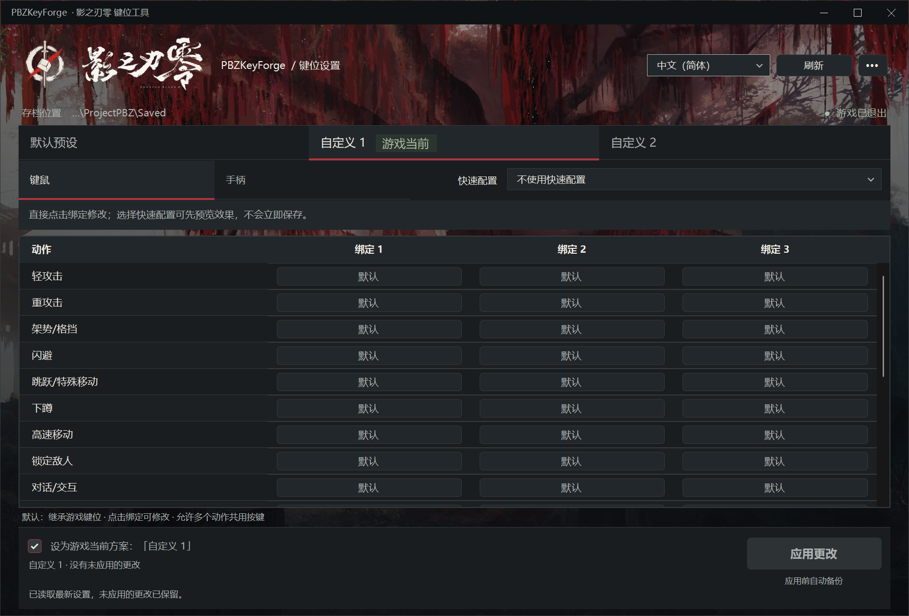

# PBZKeyForge

[Nexus Mods](https://www.nexusmods.com/phantombladezero/mods/402) · [Releases](https://github.com/muyuanjin/PBZKeyForge/releases)

**English** · [简体中文](#简体中文)

A key binding editor for **Phantom Blade Zero** that writes the game's own input settings file directly, so a single key can drive several actions at once — something the in-game rebinding screen refuses to save because it reports a conflict.

`PBZKeyForge.exe` · single file · no installer · no .NET runtime download · Windows 10/11



---

## Why this exists

Phantom Blade Zero stores your key bindings in a plain GVAS file:

```
<Steam>\steamapps\common\PBZ\ProjectPBZ\Saved\EnhancedInputUserSettings.sav
```

The in-game screen validates on **save**, not at runtime, and it rejects any binding where two actions share a key. The engine itself has no such limitation: the mapping data is a list of per-action overrides, and duplicate keys simply fire both actions. This tool edits those overrides directly, which is exactly the edit the settings screen will not let you make.

## Features

- **One key, several actions.** Guard on the attack key, dodge on the guard key, whatever you want.
- **Scheme aware.** Pick which scheme you are editing — `Default`, `Custom 1`, `Custom 2` — and switch the game to it from the tool.
- **Quick setups** for one-key guard, a Souls-style gamepad layout, and Space-based movement; restore the selected scheme's defaults from the same list.
- **15 languages** — English, 简体中文, 繁體中文, 日本語, 한국어, Français, Deutsch, Español (España / Latinoamérica), Português (Brasil / Portugal), Русский, Italiano, ไทย, Tiếng Việt. Auto-detected from Windows, switchable in the toolbar.
- **No overrides lost.** Keys you leave empty keep the game default; everything you do not touch is written back byte-for-byte.
- **Safe writes.** The game must be closed, a timestamped backup is written first, and the file is re-read and verified after saving.

## Install

1. Close Phantom Blade Zero completely.
2. Download the release zip and extract it anywhere.
3. Back up your own file first:

```
<Steam>\steamapps\common\PBZ\ProjectPBZ\Saved\EnhancedInputUserSettings.sav
```

Two ways to use it:

**A. The GUI** — run `PBZKeyForge.exe`; it finds and reads the save automatically. Choose a scheme, edit bindings or select a quick configuration, then press *Apply changes*. Switching schemes reads the latest disk data; *Refresh* also preserves unsaved drafts and asks you to resolve conflicting edits. Use *More* to choose another save.

Keyboard and gamepad drafts both belong to the selected scheme. Applying saves that scheme's bindings; other schemes' drafts stay pending. The footer lists what will be applied. Check *Set game scheme to…* to activate it in the same operation, or leave it unchecked to edit an inactive scheme. Consecutive quick configuration selections replace the previous preview; manual edits keep the result as a custom draft. *Restore all defaults* lives in *More* and previews a reset of both devices in every scheme before applying.

**B. A ready-made preset** — copy one file from `presets\` over `EnhancedInputUserSettings.sav`, then in game select the scheme named in the file name. These are plain settings files, no executable involved; pick this if you would rather not run a tool.

## Presets

| Preset | What it does |
| --- | --- |
| `onekey` | Adds guard to left mouse / X while keeping right mouse / LB and other existing guard bindings. |
| `onekey_dodge` | Moves guard to left mouse / X; right mouse / LB become dodge + sprint. Replaces the affected actions' bindings. |
| `souls` | Souls-style gamepad: light RB, heavy RT, guard LB, dodge/sprint A, interact/execute Y. |
| `space_sprint` | Adds Space as a second sprint key; Shift stays. |
| `space_dodge` | Adds Space as a second dodge key; Shift stays. |
| `vanilla` | Removes every override and returns to the shipped defaults. |

## Command line (build pipeline only)

`PBZKeyForge-cli.exe` is built by the same script but is not part of the download. The release workflow uses it to generate the preset files and to run the round-trip check, and it is handy when writing them:

```
PBZKeyForge-cli.exe --selftest <sav>
PBZKeyForge-cli.exe --schemes <sav>
PBZKeyForge-cli.exe --list <sav>
PBZKeyForge-cli.exe --apply-preset <in.sav> <out.sav> <presetId> [--scheme <profileId>]
PBZKeyForge-cli.exe --activate <installed.sav> <profileId>
PBZKeyForge-cli.exe --make-vanilla <in.sav> <out.sav>
PBZKeyForge-cli.exe --gen-presets <in.sav> <outDir>
```

`--selftest` re-encodes the file without changes and compares it byte-for-byte with the input; it is the acceptance test this project is built around.

Activating a scheme edits only `KeyBindingScheme` in the adjacent `PBZSharedSetting.sav`. The game must be closed. The tool backs up that file outside the game folder, authenticates it, and verifies the replacement before writing. Reading this setting requires the installed Steam executable; unsupported builds are rejected. The profile identifier in `EnhancedInputUserSettings.sav` does not control the game's selected scheme.

## Important

- **Do not open the in-game keybind screen and press apply or reset after using this tool.** The game validates on its own save and rewrites the whole file, discarding these bindings. If you do, just re-apply.
- Only one mod that replaces `EnhancedInputUserSettings.sav` can be active at a time.
- Editing an inactive scheme's keyboard and gamepad bindings is supported. Check *Set game scheme to…* and press *Apply changes* when you want the game to use it. Gamepad records are matched by `ProfileId`; another scheme's records are preserved even when their `Family` values are identical.
- Tested against the Steam launch build (`CL-301524`). A game update may change the file layout; the tool refuses to write if it cannot parse the file.

## Build from source

No SDK required — the .NET Framework compiler that ships with Windows is enough.

```powershell
powershell -ExecutionPolicy Bypass -File build\build.ps1
```

Outputs `dist\PBZKeyForge.exe` (GUI) and `dist\PBZKeyForge-cli.exe` (console, build pipeline only).

## License

MIT. Not affiliated with S-Game. Use at your own risk, keep the backup.

---

## 简体中文

直接改写《影之刃零》自己的按键设置文件，让一个键同时触发多个动作——游戏内的改键界面会因为"按键冲突"拒绝保存，而引擎本身并不限制这件事。

`PBZKeyForge.exe` · 单文件 · 免安装 · 不需要额外下载 .NET 运行时 · Windows 10/11

### 为什么需要它

游戏把键位存在一个明文 GVAS 文件里：

```
<Steam>\steamapps\common\PBZ\ProjectPBZ\Saved\EnhancedInputUserSettings.sav
```

游戏界面只在**保存时**校验，而运行时并不拦；数据本身就是一组"按动作覆盖"的记录，同一个键写进两个动作就会同时触发。这个工具改的就是这些记录——也正是游戏界面不让你做的那一步。

### 功能

- **一个键多个动作**：防御并到攻击键、闪避并到防御键，随便配。
- **认方案**：可选编辑 `默认 / 自定义方案 1 / 自定义方案 2`，并能在工具里直接把某个方案设为游戏当前生效方案。
- **7 个预设**：一键攻防、一键攻防+防御键改闪避、魂系手柄布局、空格冲刺、空格闪避、撤销一键攻防、恢复默认。
- **15 种语言**：简中、繁中、英、日、韩、法、德、西班牙西语、拉美西语、巴西葡语、葡萄牙葡语、俄、意、泰、越，覆盖游戏的界面语言；自动识别系统语言，也能在工具栏切换。
- **不丢键位**：留空的格子保持游戏默认；没碰到的内容按原字节写回。
- **写入安全**：游戏必须退出、先打时间戳备份、写完回读校验。

### 安装

1. 完全退出游戏。
2. 解压发布包。
3. 先备份你自己的 `EnhancedInputUserSettings.sav`。

两种用法：

- **图形界面**：运行 `PBZKeyForge.exe` 自动查找并读取存档 → 选方案 → 直接改键或选择快速配置 → 应用更改。“更多”中可以更换存档。
- **现成预设文件**：把 `presets\` 里对应文件覆盖到 `EnhancedInputUserSettings.sav`，进游戏选文件名里的那个方案。纯配置、不含可执行文件，介意杀毒的同学用这个。

### 重要提醒

- **不要**在用完之后进游戏打开键位界面点"应用"或"恢复默认"，游戏会整份重写、把这些键位冲掉；真冲掉了重新套一次即可。
- 同类会替换 `EnhancedInputUserSettings.sav` 的 mod 只能同时装一个。
- 切换方案会重新读取磁盘最新数据；“刷新”保留未应用草稿，同一绑定被双方修改时需选择保留哪一项。键鼠和手柄草稿均按方案保存，只应用当前编辑方案，底栏显示此次范围。
- 编辑非当前方案后，勾选“设为游戏当前方案”再“应用更改”即可启用；不勾选可只保存键位。连续选择快速配置会替换上一次预览，手动编辑后保留为自定义；“更多 → 全部恢复默认”先预览全部方案的键鼠和手柄重置，再统一应用。游戏运行时会单独提示并禁用应用，仍可编辑草稿。手柄记录按 `ProfileId` 匹配，`Family` 相同也不会顺带改动其他方案。
- 方案启用只修改同目录 `PBZSharedSetting.sav` 的 `KeyBindingScheme` 字段，先在游戏目录外备份，再认证回读校验。需完全退出游戏，并能找到支持版本的 Steam 游戏程序。`EnhancedInputUserSettings.sav` 内的方案标识不决定游戏选择哪个方案。
- 针对 Steam 首发版本（`CL-301524`）验证；游戏大更新后文件结构可能变化，工具解析不了时会拒绝写入。

### 从源码构建

不需要 SDK，Windows 自带的 .NET Framework 编译器就够：

```powershell
powershell -ExecutionPolicy Bypass -File build\build.ps1
```

产物：`dist\PBZKeyForge.exe`（界面）与 `dist\PBZKeyForge-cli.exe`（命令行，仅供构建流程使用）。

### 许可

MIT。与 S-Game 无关，使用风险自负，记得留备份。


